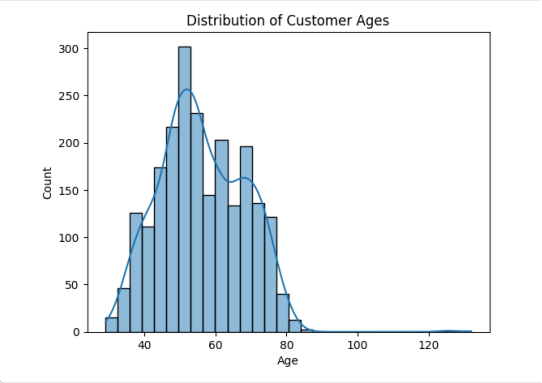
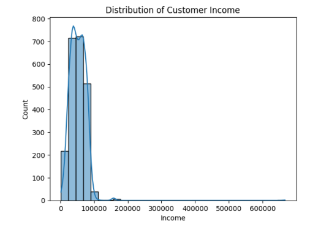
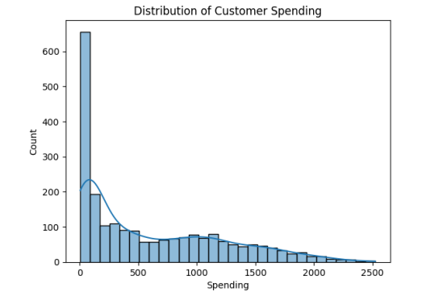
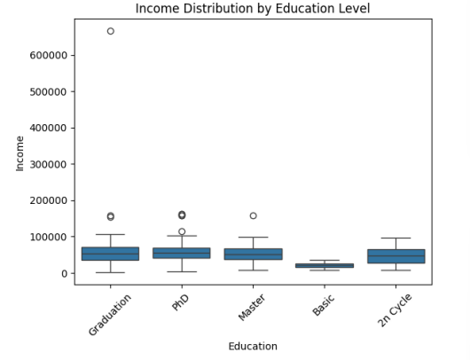
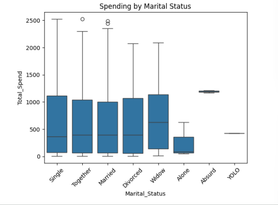
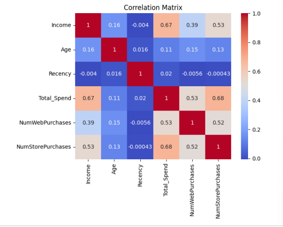
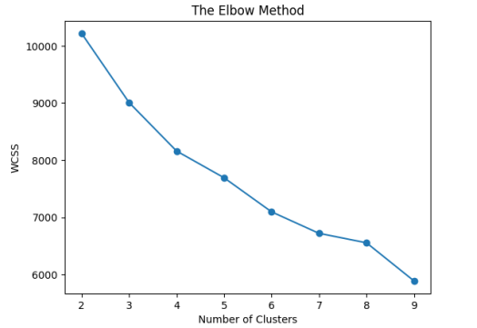

# Customer Segmentation Analysis

A Python-based customer analytics and machine-learning project that uses Exploratory Data Analysis (EDA), feature engineering, data visualization, and K-Means clustering to identify customer groups based on demographic and purchasing characteristics.

---

## Project Overview

This project analyzes customer marketing data containing demographic information, income, product spending, purchase-channel activity, recency, and campaign-response details.

The objective is to understand customer behavior, identify purchasing patterns, explore relationships between customer attributes, and segment customers using the K-Means clustering algorithm.

The project was developed using Python in Google Colab. The analysis report and Python visualization script are included in this repository.

## Objectives

- Analyze customer demographics and purchasing behavior.
- Inspect and clean the customer dataset.
- Explore income and spending patterns.
- Perform feature engineering to create meaningful customer attributes.
- Visualize relationships between customer variables.
- Apply feature scaling before clustering.
- Use the Elbow Method to evaluate candidate cluster counts.
- Perform customer segmentation using K-Means.
- Analyze and compare the resulting customer clusters.

## Dataset

The dataset contains **2,240 customer records and 29 original columns**.

After removing records with missing income values, **2,216 customer records** remain for analysis.

### Dataset Attributes

| Category | Attributes |
|---|---|
| Customer Information | ID, Year_Birth, Education, Marital_Status, Income |
| Household Information | Kidhome, Teenhome |
| Customer Activity | Dt_Customer, Recency |
| Product Spending | MntWines, MntFruits, MntMeatProducts, MntFishProducts, MntSweetProducts, MntGoldProds |
| Purchase Channels | NumDealsPurchases, NumWebPurchases, NumCatalogPurchases, NumStorePurchases, NumWebVisitsMonth |
| Campaign Information | AcceptedCmp1, AcceptedCmp2, AcceptedCmp3, AcceptedCmp4, AcceptedCmp5 |
| Response Information | Complain, Response |
| Additional Fields | Z_CostContact, Z_Revenue |

**Dataset Note:** The original dataset is not included in this repository. Obtain it from its original provider and follow its terms of use before redistribution.

## Tools and Technologies

- **Programming Language:** Python
- **Environment:** Google Colab
- **Data Manipulation:** Pandas, NumPy
- **Data Visualization:** Matplotlib, Seaborn
- **Machine Learning:** Scikit-learn
- **Algorithm:** K-Means Clustering
- **Dimensionality Reduction:** Principal Component Analysis (PCA)

## Project Workflow

### 1. Data Loading and Inspection

- Imported the customer dataset using Pandas.
- Reviewed dataset dimensions and column information.
- Inspected sample records and descriptive statistics.
- Identified missing values and examined data types.

### 2. Data Cleaning

- Identified 24 missing values in the Income column.
- Removed records containing missing income values.
- Retained 2,216 customer records for analysis.
- Converted Dt_Customer into datetime format.

An unusually high income value of `666666` was also identified during descriptive analysis. It requires further investigation before drawing conclusions from income-related results.

### 3. Feature Engineering

Created additional features to support customer analysis:

| Feature | Description |
|---|---|
| Age | Calculated using 2025 minus Year_Birth |
| Total_Children | Sum of Kidhome and Teenhome |
| Total_Spend | Sum of the six product spending columns |
| Customer_Since | Elapsed days since customer enrollment |
| AcceptedAny | Indicates whether at least one selected campaign/response field was positive |
| AgeGroup | Groups customers into age categories |

**Reproducibility Note:** Age uses 2025 as a fixed reference year in the notebook. Customer_Since uses the execution date, so its value changes when the notebook is rerun.

## Data Visualizations

The following charts explore customer demographics, income, spending behavior, and relationships between numerical variables.

### 1. Customer Age Distribution



**Image Path:** `visualizations/01_age_distribution.png`

Shows the distribution of customer ages and helps identify the age ranges represented in the dataset.

### 2. Customer Income Distribution



**Image Path:** `visualizations/02_income_distribution.png`

Displays the distribution of customer income and helps identify income concentration and potential extreme values.

### 3. Customer Spending Distribution



**Image Path:** `visualizations/03_customer_spending.png`

Illustrates the distribution of total customer spending across the six product categories.

### 4. Income Distribution by Education Level



**Image Path:** `visualizations/04_income_education_level.png`

Compares income distributions across different education groups.

### 5. Spending by Marital Status



**Image Path:** `visualizations/05_spending_by_marital_status.png`

Compares customer spending across marital status categories.

### 6. Correlation Matrix



**Image Path:** `visualizations/06_correlation_matrix.png`

Visualizes correlations between income, age, recency, total spending, and purchase-channel activity.

### 7. Elbow Method – K-Means Clustering



**Image Path:** `visualizations/07_elbow_method.png`

Displays the Within-Cluster Sum of Squares (WCSS) for different cluster counts to help evaluate the K-Means clustering configuration.

## Customer Segmentation Using K-Means

K-Means clustering was applied to group customers based on selected demographic and purchasing characteristics.

### Features Used for Clustering

The following seven numerical features were selected:

1. Age
2. Income
3. Total_Spend
4. NumWebPurchases
5. NumStorePurchases
6. NumWebVisitsMonth
7. Recency

### Feature Scaling

StandardScaler from Scikit-learn was used to standardize the selected features before applying K-Means.

### Model Configuration

- Algorithm: K-Means Clustering
- Candidate cluster counts: 2 to 9
- Cluster count selected: 6
- Evaluation approach: Elbow Method
- Number of selected features: 7

## Cluster Analysis

The resulting six clusters show differences in customer demographics, income, spending, and purchasing activity.

### Cluster Profile

| Cluster | Age | Income | Total Spend | Web Purchases | Store Purchases | Web Visits / Month | Recency |
|---:|---:|---:|---:|---:|---:|---:|---:|
| 0 | 55.22 | 5,165.78 | 88.56 | 0.33 | 0.22 | 17.33 | 43.33 |
| 1 | 52.37 | 34,773.54 | 120.39 | 2.24 | 3.39 | 6.41 | 24.10 |
| 2 | 59.75 | 59,512.23 | 879.62 | 7.96 | 7.79 | 6.44 | 46.75 |
| 3 | 54.96 | 36,548.55 | 135.28 | 2.42 | 3.49 | 6.38 | 74.96 |
| 4 | 46.60 | 78,013.16 | 1,301.58 | 4.68 | 8.68 | 2.72 | 48.94 |
| 5 | 70.13 | 72,362.11 | 1,137.83 | 4.48 | 8.25 | 2.73 | 51.61 |

### Cluster Sizes

| Cluster | Number of Customers |
|---:|---:|
| 0 | 9 |
| 1 | 560 |
| 2 | 421 |
| 3 | 544 |
| 4 | 349 |
| 5 | 333 |
| **Total** | **2,216** |

### Cluster Observations

- Cluster 0 has the lowest average income and spending and contains only 9 customers.
- Cluster 4 has the highest average total spending.
- Cluster 5 has the highest average age.
- Clusters 2, 4, and 5 show higher average spending than the other clusters.
- The clusters differ in web purchases, store purchases, and recency.

These are descriptive observations based on the reported cluster averages. The clusters have not been assigned validated business labels.

## Key Findings

- The cleaned dataset contains 2,216 customer records.
- Income and total spending show a positive correlation of approximately **0.668**.
- Total spending and store purchases show a positive correlation of approximately **0.675**.
- Average spending varies across education groups.
- Cluster 4 has the highest mean total spending.
- Cluster 0 contains only 9 customers and requires further investigation.
- The six-cluster model provides a starting point for exploring customer purchasing differences.

## PCA – Principal Component Analysis

Principal Component Analysis (PCA) was included in the notebook workflow to transform standardized customer features into a two-dimensional representation.

The supplied PDF report does not show a completed PCA visualization or its interpretation. This part of the analysis remains a potential improvement.

## How to Run the Project

### 1. Clone the Repository

```bash
git clone https://github.com/thefavmaverick-coder/Customer-Segmentation-Analysis.git
```

### 2. Navigate to the Project Folder

```bash
cd Customer-Segmentation-Analysis
```

### 3. Install Dependencies

```bash
pip install -r requirements.txt
```

### 4. Add the Dataset

Place the source CSV file in the project folder and name it:

```text
customer_segmentation.csv
```

### 5. Generate Visualizations

Run:

```bash
python customer_visualizations.py
```

The generated chart images will be saved in the `visualizations/` directory.

**Note:** The Python visualization script generates the seven EDA and Elbow Method charts. The K-Means cluster summary in this README is based on the reported notebook results.

## Limitations and Future Improvements

- Investigate the unusually high income value before finalizing the analysis.
- Compare dropping missing income records with suitable imputation methods.
- Evaluate clustering quality using the Silhouette Score.
- Investigate the very small cluster containing 9 customers.
- Test cluster stability with different initialization settings.
- Use a fixed reference date for Customer_Since.
- Complete the PCA visualization and interpretation.
- Save the fitted scaler and K-Means model for future customer predictions.
- Develop an interactive dashboard or application to explore customer segments.

## Conclusion

This project demonstrates a customer analytics workflow using Python, from data inspection and cleaning to exploratory analysis, feature engineering, visualization, and K-Means clustering.

The six-cluster solution provides a structured way to explore differences in customer income, spending, purchasing channels, and recency. The analysis identifies variations between customer groups and highlights areas that require additional investigation, including the unusually high income value and the small cluster containing only nine customers.

Overall, this project demonstrates how data analytics and unsupervised machine learning can transform customer data into meaningful patterns that support customer understanding and data-driven business decisions.

---

## Project Information

**Project Name:** Customer Segmentation Analysis  
**Category:** Data Analytics | Machine Learning | Customer Analytics  
**Programming Language:** Python  
**Environment:** Google Colab  
**Algorithm:** K-Means Clustering  

**GitHub Repository:**  
https://github.com/thefavmaverick-coder/Customer-Segmentation-Analysis

**Portfolio:**  
https://ambi-rajan-portfolio.vercel.app/

**LinkedIn:**  
https://www.linkedin.com/in/ambi-rajan005/